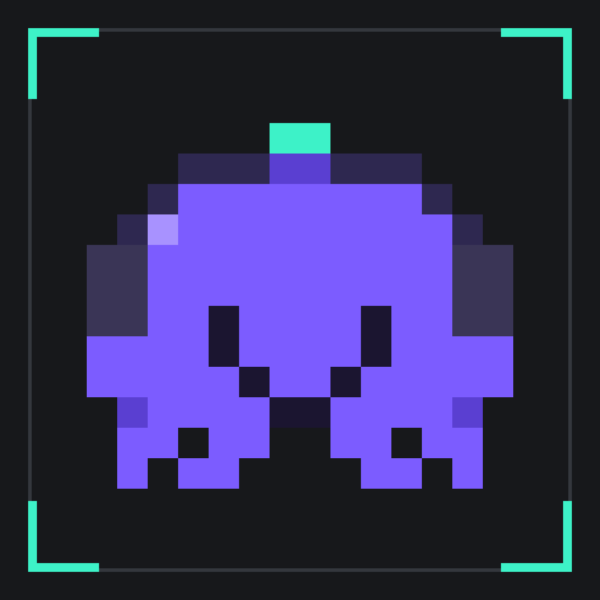
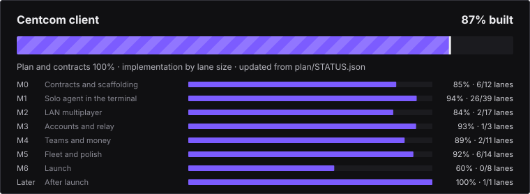
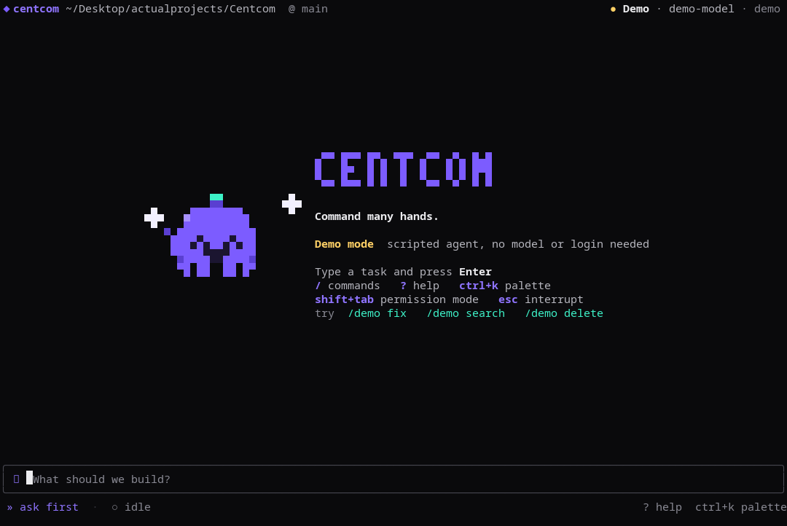
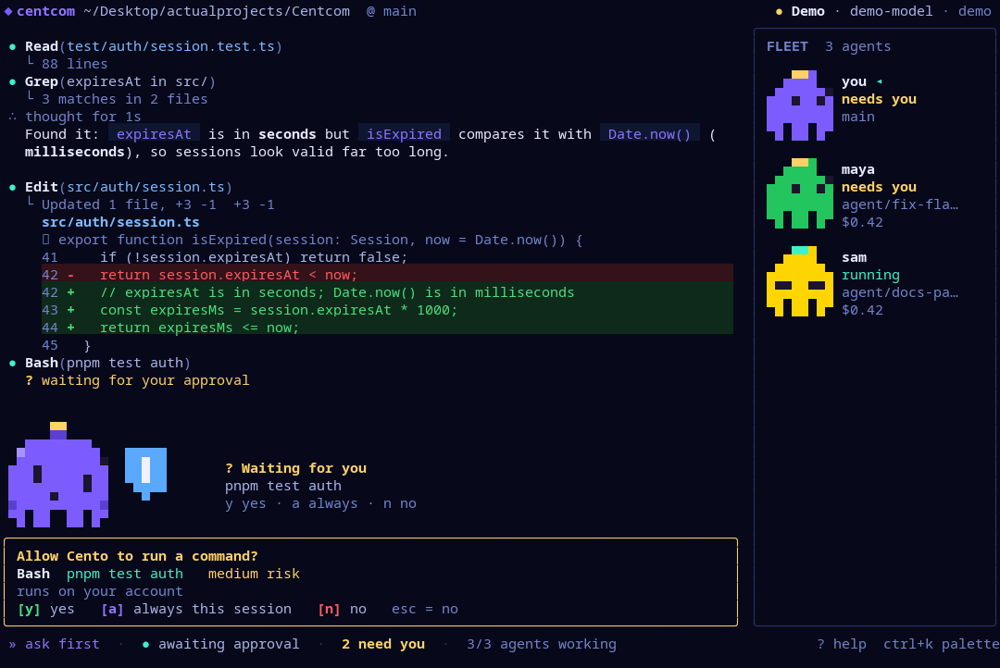

# Centcom

<p align="left"></p>

Command many hands. A terminal-first, multiplayer platform for running coding agents (it drives your own Claude Code and Codex CLIs; we never touch your login): several people and several agents in one workspace, over LAN or a hosted relay. Mascot: **Cento** the octopus.

> Status: **building.** The terminal app (with Cento), the Claude Code and Codex engines, real approvals, the local web app and auto skills work today. Multiplayer, accounts and the backend are still plans. See [Progress](#progress) and [`plan/`](plan/README.md).


<!-- progress:start -->

## Progress



**90% built** (weighted by lane size across 105 lanes). Details and how this is computed: [`tools/plan/progress.py`](tools/plan/progress.py). Update [`plan/STATUS.json`](plan/STATUS.json) when you finish or advance a lane, then run `python3 tools/plan/progress.py`.

## Next steps

1. **Release signing and hosting** — the app already checks for updates on every start (C095), but no standalone update is accepted until the release signing keys, published artifacts and the /v1/releases endpoint exist
2. **Wire the new runtime pieces into the app** — permissions, memory, MCP, hooks, context, checkpoints, locks and the fleet are built and tested as libraries; the terminal and web app do not use most of them yet
3. **Finish the M1 terminal lanes** — C036 transcript view, C043 task list, C045 keybindings and help, C048 onboarding
4. **Multiplayer client against the mock backend** — M2 lanes (transport, relay client, crypto, sessions, queue, LAN) can be built and tested against the C007 mock backend before the real backend exists
5. **Decisions waiting for people** — web device keys (docs/proposals/web-device-keys.md) and the queue item id (docs/proposals/queue-item-id.md) need Contract PRs; release signing keys and hosting; chunking messages over 192 KiB; an agent behind the LAN host (centcom lan host has the server, pairing and engine but no runner)

### Started, not finished

| Lane | What | Done | Note |
|---|---|--:|---|
| [C034](plan/client/C034.md) | TUI shell: Ink app skeleton, layout, resize | 94% | Shell frame (header/scrollback/toast/prompt/footer, 100-col rail, overlay, too-small state), renderApp with debounced resize, alt-screen guard for exit/SIGINT/SIGTERM/uncaught error, action registry with focus stack, grapheme-aware text helpers; --no-alt-screen wired and checked in a real terminal; gaps: App.tsx not moved onto the Shell, no lint rule for raw Text; resize repaints the whole frame, small-terminal layouts (pickers, help, overlays), width tests, tab title and terminal restore on every exit path | 2026-10-14: App.tsx is drawn by the shell: header, scrollback, prompt region (grows past 12 rows for the strip, tasks and permission question), footer, rail from 100 columns (#183), checked in a real terminal; gaps: no lint rule for raw Text, the frame repaints fully on resize, small-terminal layouts of pickers and help |
| [C037](plan/client/C037.md) | Diff view | 94% | unified-diff parser with caps (2,000 lines, 200 files, 50k lines in <300 ms), two-string differ, camelCase-aware word highlights, row layout with numbered gutter, wrapping, gap folding/expansion, binary/rename rows, DiffView with focusable gaps, diff.share adapter; the approval prompt now shows an edit's numbered diff (checked with the real Claude Code); gap: the transcript still uses util/diff.ts; diff view notes rows | 2026-10-14: the transcript draws diffs with this module too (#189) |
| [C041](plan/client/C041.md) | Command palette | 94% | palette core: DP fuzzy matcher with indices, engine (debounce, abort, slow-provider append, fixed group order, recent), list and file providers (git ls-files or walk, 20k cap, sliced scoring), view and live component (60/cols-4 wide, 8 rows + more row, wrap-around keys), palette.* actions; gap: the app still shows its older palette, sessions/skills providers not wired; palette with ranking and click, entries from the command list; /settings and pickers on one picker model | 2026-10-14: the palette is checked inside the app: ctrl+k, a query across commands and files, Esc keeps the draft (#189) |
| [C044](plan/client/C044.md) | Toast and notice system | 94% | toast controller in the app (one at a time, queue of 20, severity preemption, errors stay until ctrl+y/Esc, repeats counted xN, action keys), sys.notice table shown for the service's notices; gaps: bus event toast.dismissed not wired | 2026-10-14: a notice that goes away is announced on the bus as toast.dismissed with its id, level and how (#189) |
| [C049](plan/client/C049.md) | TUI accessibility: reduced motion, NO_COLOR, screen-reader mode | 94% | mode resolution, MotionProvider, sentences for all 64 states, linear renderer with y/n/a permission prompt and Status:/Error: announcements, no-colour/no-escape test helpers, conformance for task list and progress bar; gaps: linear mode not started from main.tsx, a11y.screenReader config key, conformance for the other components; screen-reader mode (plain lines, zero escape codes), NO_COLOR conformance over 14 screens, reduced motion, high-contrast theme | 2026-10-14: screen-reader mode is started from main.tsx (it was already) and is now tested in a real pty: zero escape sequences, the permission question is one line (#184); gap: conformance for the remaining components |
| [C071](plan/client/C071.md) | LAN discovery over mDNS | 94% | mDNS advertiser and browser (probe, announce, goodbye, query schedule, TTL expiry, name conflicts, member-count updates), DNS-SD codec, TXT validation, fuzz, no-secrets packet scan, --no-announce, centcom lan scan; run on the real network (real UDP multicast on wlan0/docker/tailscale interfaces: found by the real centcom lan scan, goodbye removes it, tools/dev/lan-live.ts); gap: it also announces container and virtual interface addresses | 2026-10-14: mDNS no longer announces on container and virtual interfaces unless named with --bind (#188) |
| [C014](plan/client/C014.md) | Agent session state machine emitting contract state names | 93% | state machine and emitter; property test over random legal streams (400 runs: states on the contract list, calm state after a turn, idle after interrupt, open approval never displaced, crash is final); gaps: golden transcripts from real parsers | 2026-10-14: the state machine is run over the real claude recordings (a plain answer and an interrupted turn: the agent ends idle with no error on the way) (#184); gap: golden transcripts from the real Codex parser |
| [C031](plan/client/C031.md) | Terminal capability detection and colour tiers | 93% | terminal capability module (tier matrix, unicode, half-block, hyperlink/paste flags, typed CENTO_* env with warnings, OSC 11 background query with 150 ms bound, layout class, mascotAllowed, debounced watchSize); the app now starts from it for colour depth (shared detection, the colour setting on top) and says an unclear CENTO_* value in words; gaps: components still use the older theme helpers, Unicode/ASCII fallback is not switched by caps.unicode yet | 2026-10-14: the app uses its colour depth and every colour now comes from the colour module (#183); gaps: Unicode/ASCII fallback is chosen from the colour tier, not from caps.unicode |

+54 more in [`plan/STATUS.json`](plan/STATUS.json).

### Ready to pick up (all dependencies done)

| Lane | What | Size | Milestone |
|---|---|---|---|

Each lane card lists its goal, contracts, acceptance criteria and tests. Read [`plan/START_HERE.md`](plan/START_HERE.md) first.

<!-- progress:end -->

## What is in this repo

| Path | What |
|---|---|
| [`plan/`](plan/START_HERE.md) | The build plan (start with `plan/START_HERE.md` and `plan/ROADMAP.md`): 101 backend lanes + 105 client lanes, architecture, strict guidelines, integration gates |
| [`contracts/`](contracts/README.md) | Frozen connection points shared with the backend repo (REST, WebSocket, events, crypto, LAN, billing) |
| [`assets/DESIGN.md`](assets/DESIGN.md) | Design system: brand, mascot, colour, type, motion, components, voice, accessibility |
| [`assets/theme/`](assets/theme) | Graphite/Paper theme: tokens, CSS, Tailwind preset, terminal themes, live preview |
| [`assets/mascot/`](assets/mascot) | Cento: 319 animations, 5 colours, crowds, gallery, terminal player |
| [`assets/The-Lines.txt`](assets/The-Lines.txt) | 743 spinner lines |
| `tools/plan/` | Plan, contract and lock tooling |

The server lives in the private repo `Caffeine-Driven-LLC/Centcom-backend`; both repos carry identical `contracts/`, `plan/` and `tools/plan/`.

## Run the terminal app

```sh
pnpm install
pnpm dev                 # scripted demo agent, no login needed
pnpm centcom             # drives your own Claude Code (must be installed and signed in)
```

Approvals work with real Claude Code: Centcom runs `claude` with `--permission-mode manual` and a tiny MCP tool (`--permission-prompt-tool`) that asks the app over a private local socket, so the dialog with the diff appears for every Write/Edit/Bash that needs one. If the app is unreachable the answer is always deny.

Try `/demo fix`, `/demo search` and `/demo delete` in demo mode (add `--demo-team` to preview teammates), `ctrl+k` for the palette, `/cento` for the 319-animation gallery, `?` for keys.
Flags: `--mode plan|acceptEdits`, `--mascot large|small|off`, `--cento-color red|yellow|green|brown`, `--theme light|hc`, `--colors 256|16|never`, `--no-motion`, `--screen-reader` (plain lines for a screen reader). A mistyped option is a one-line error, not a silent no-op.

The terminal app in short: shift+arrows jump and select words, `ctrl+c` copies, the mouse wheel and clicks work (`/mouse off` for your terminal's own selection), `@` mentions a project file, `ctrl+k` searches commands, files, conversations and skills, `ctrl+r` your earlier messages, `/settings` shows every setting, `/find`, `/copy` and `/export` take things with you, and most commands open a list when you give them no value. Everything is in [docs/site/guide/terminal-app.md](docs/site/guide/terminal-app.md).




**Auto skills:** before each prompt Centcom matches your installed skills and commands (`~/.claude/skills`, plugins, `.claude/skills`, `.claude/commands`) against it locally, shows what it picked, and tells Claude to apply them. `/auto on|off`, `/skills [filter]`.

**The `centcom` command:** `pnpm onboard` (checks Node/pnpm/git, installs, links the command, reports which agents it found; `sh tools/dev/onboard.sh --check` only reports) or `pnpm install && pnpm install:cli` once, then run `centcom` in any folder to start the terminal app there, the way you start `claude` (`centcom --engine codex`, `centcom --help`). It runs from this checkout, so `git pull` is an update.

**Night cycle:** `ctrl+n` (or `/night`) opens a queue: write many tasks, press Enter on an empty line, and the agent works through them while you sleep, never asking you anything. Questions are answered "decide yourself"; high-risk actions and anything that pushes, publishes or deploys are refused; a morning report is written to `~/.centcom/night/`. See [`docs/night-cycle.md`](docs/night-cycle.md).

**Skill library:** seven skills ship with Centcom in `packages/skills/library` (design, frontend, backend, security, database, marketing, code-review): each a `SKILL.md` plus `references/` the agent reads only when the task needs that depth, and a few stdlib-only helper scripts. They are matched like any other skill, the agent is pointed at the file, and your own project skills of the same name win. See `packages/skills/library/README.md`.

**centcom-master:** `pnpm skills:sync` fetches the curated catalog in `packages/skills/catalog.tsv` (245 rows from ~70 repos) into `~/.centcom/master`: text files only (scripts are left out), pinned to a commit, scanned for prompt-injection and obfuscation, and exposed as one router skill with an index. Per prompt the matcher injects only the best 1 to 3 (by file path), never the whole bundle. Trusted publishers are on by default; overlapping, hook-dependent and unknown-publisher skills are off. `/skills enable <id>` and `/skills disable <id>` change that.

`tools/dev/shot.py` runs the app in a pseudo-terminal and saves a screenshot (needs `pip install pyte pillow`). Checks: `pnpm typecheck && pnpm test`.

## Desktop app

```sh
pnpm app          # builds the app and opens it as a desktop window (Electron)
pnpm web:dev      # the same screens in a browser tab, for development
```

The desktop app (`apps/desktop`, screens in `apps/web`) is a window around the Centcom screens: sign in, workspaces, sessions, the fleet board, billing and settings. It opens `centcom://` links, keeps the page sandboxed, and sends outside links to your browser. Electron's binary needs one extra step the first time: see [`apps/desktop/README.md`](apps/desktop/README.md). The terminal app (`pnpm centcom`) is where agents run today.

## Scripting and saved conversations

```sh
centcom -p "summarise this repo"                   # run once, print the answer, exit
cat error.log | centcom -p "what went wrong?"      # piped text is added to the prompt
centcom -p "..." --output-format json              # result, usage, cost, session id as one JSON object
centcom -c                                         # continue the last conversation in this folder
centcom --resume ses_...                           # continue a specific one (list them with /resume)
```

Conversations are saved to `~/.centcom/sessions` (private files) and resumed through the agent's own session, so it remembers what was said. `/new` starts fresh and keeps the old one. Print mode declines anything that needs an approval and says so (exit code 3); allow it with `--mode acceptEdits` or `--dangerously-skip-permissions`. Exit codes: 0 done, 1 error, 2 bad usage, 3 an action was declined. Turn saving off with `--no-save`.

## Remembered settings

Centcom remembers what you choose: theme, Cento's size and color, model, permission mode, auto skills, the side panel, your last agent and your prompt history (per project). Settings come from five layers (defaults, your user file, a project file, environment, flags); `/config` shows each value and where it came from. A project file can't change anything risky, credentials in config files are refused, and skip-permissions is never saved. Details: [`docs/configuration.md`](docs/configuration.md).

## Try the mascot

```bash
cd assets/mascot
python3 play.py --tour                 # every animation in your terminal (true-colour terminal)
python3 play.py typing --color red     # one animation, any of 5 colours
xdg-open gallery.html                  # browse, recolour, tile into crowds
```

All generated GIFs (5 colours + duo/trio/squad/group crowds) are committed under `assets/mascot/gif/`; regenerate with `python3 assets/mascot/build.py`.

## Check the plan and contracts

```bash
python3 tools/plan/validate_contracts.py
python3 tools/plan/validate_plan.py
python3 tools/plan/lock.py --check
```
